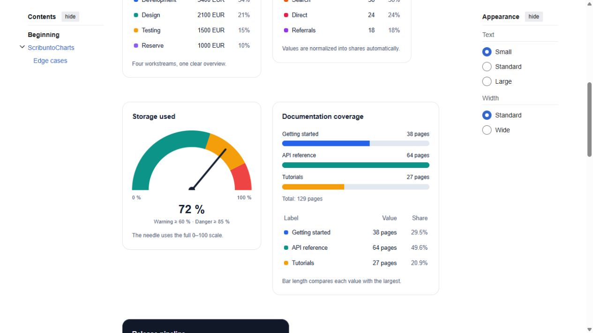

# ScribuntoCharts

**CSS-only charts for MediaWiki. One Lua module, six chart types, no JavaScript.**

Donut and pie charts, a semicircular gauge with a needle and threshold bands,
horizontal bars, a stacked bar, and a progress indicator. Charts are rendered by
Scribunto as HTML and inline CSS. No TemplateStyles, API extension, external
service, images, canvas, or client-side chart library is required.



[View the full gallery screenshot](docs/gallery.jpg) · [Copy the gallery wikitext](examples/Gallery.wikitext)

## Install

1. Enable **Scribunto** on your MediaWiki installation.
2. Create **Module:Charts** and copy the contents of [Charts.lua](Charts.lua).
3. Paste an invocation below into a normal wiki page.

The module targets MediaWiki **1.43+**. CI runs the actual Lua module and MediaWiki
parser on the 1.43, 1.44, 1.45 and 1.46 release lines. Use a modern browser with
CSS `conic-gradient` and `aspect-ratio` support. Data is also available as ordinary
text and semantic tables if graphics are unavailable. A skin or site policy that
removes inline styles will affect the graphics.

**По-русски:** скопируйте `Charts.lua` на страницу `Module:Charts`, затем вставьте
пример на вики-страницу. Параметр `lang=ru` включает русские служебные подписи.
Модуль работает без JavaScript и без установки дополнительных расширений, кроме
Scribunto. [Полная галерея для копирования](examples/Gallery.wikitext).

## Quick start: a donut

```wikitext
{{#invoke:Charts|donut
 |title=Бюджет проекта
 |lang=ru |unit=EUR
 |label1=Разработка |value1=5400 |color1=#2563eb
 |label2=Дизайн |value2=2100 |color2=#0d9488
 |label3=Тестирование |value3=1500 |color3=#f59e0b
 |label4=Резерв |value4=1000 |color4=#8b5cf6
 |caption=Плановые расходы по направлениям.
}}
```

Values are normalized into slices automatically. The center shows the total;
the table contains every label, value and percentage. Change `donut` to `pie`
for a solid circular chart. Use `hole=72` for a thinner ring.

## Gauge: a speedometer for a bounded metric

```wikitext
{{#invoke:Charts|gauge
 |title=Storage used |value=72 |unit=%
 |min=0 |max=100 |warning=60 |danger=85
 |caption=Warning at 60%, danger at 85%.
}}
```

The needle moves from left (minimum), through the top (midpoint), to right
(maximum). Thresholds are **values in the same units as the metric**, not
percentages of the scale. For temperature, for example:

```wikitext
{{#invoke:Charts|gauge|title=Temperature|value=-5|min=-40|max=40
 |warning=10|danger=25|unit=°C|theme=dark}}
```

An out-of-range value is still displayed accurately. Only the needle is clamped,
and a visible notice explains it. These default bands model **higher is worse**;
choose colors and thresholds appropriate for your metric.

## Bars, stacked shares and progress

```wikitext
{{#invoke:Charts|bars|title=Documentation coverage|unit=pages
 |label1=Getting started|value1=38
 |label2=API reference|value2=64
 |label3=Tutorials|value3=27}}

{{#invoke:Charts|stacked|title=Release pipeline|theme=dark
 |label1=Ready|value1=42|color1=#2dd4bf
 |label2=In review|value2=18|color2=#60a5fa
 |label3=Blocked|value3=6|color3=#fb7185}}

{{#invoke:Charts|progress|title=Translation goal
 |value=840|max=1200|unit=pages|color=#0d9488}}
```

Bars compare against the **largest value** in the series. The stacked bar compares
each value against the **total**. Progress fills `(value - min) / (max - min)`;
its default range is 0–100. For a percentage, use `unit=%` explicitly.

The generic entry point also works: `{{#invoke:Charts|chart|type=pie|value1=3|value2=7}}`.
Arguments are read from the invocation itself. In a template wrapper, forward
parameters explicitly, for example `|value={{{value|0}}}`.

## Use from another Lua module

```lua
local charts = require('Module:Charts')
local p = {}

function p.workload()
    return charts.render({
        type = 'bars', title = 'Open work', size = 420,
        series = {
            { label = 'Documentation', value = 12 },
            { label = 'Bugs', value = 7, color = '#e11d48' },
            { label = 'Features', value = 18 }
        }
    })
end

return p
```

`render(config)` returns a string ready for a module's return value. It accepts
the same options as the wikitext interface; `series` is a consecutive Lua array
of `{ label, value, color }` records, with `value` required. When present, `series`
supplies the items instead of the numbered arguments. There is also a complete
[Module:ChartData example](examples/ChartData.lua).

## Options

| Option | Meaning / default |
|---|---|
| `type` | `donut` (default), `pie`, `gauge`, `bars`, `stacked`, `progress`. Named entry points fix the type. |
| `title`, `caption` | Optional plain-text title and description. |
| `lang` | `en` (default) or `ru` for built-in labels and notices. Validation messages are English. |
| `unit` | Plain-text suffix shown with values, e.g. `%`, `EUR`, `pages`, `°C`. |
| `size` | Maximum graphic width in pixels, 120–640. Default 260 for round charts/gauges, 420 for bars/stacked/progress. The card adds 40 px of padding and shrinks to its container. |
| `decimals` | 0–4, default 1. Display rounding only; trailing zeroes are removed. Tiny nonzero values use three significant digits instead of becoming zero. Calculations use the original values. |
| `theme` | `light` (default) or `dark`; explicit, independent of the skin theme. |
| `background` | Optional hex card/hole background. Text color follows `theme`; choose compatible colors. |
| `palette` | `ocean` (default), `sunset`, `forest`, `mono`. Colors repeat after six items. |
| `label1` … `label30` | Plain-text item names; default `Item N`. |
| `value1` … `value30` | Required consecutive non-negative values for series charts. Decimal point, not comma. |
| `color1` … `color30` | Optional per-item hex colors, overriding the palette. |
| `hole` | Donut hole diameter as a percentage of the outer diameter, 35–85; default 64. |
| `centerlabel` | Label for the total, default `Total` / `Всего`. |
| `value`, `min`, `max` | Gauge/progress metric and scale. `value` is required, defaults for the scale are 0 and 100. Negative scale values are supported. |
| `warning`, `danger` | Gauge thresholds. Default 60% and 85% along the scale. Must satisfy `min < warning < danger < max`. |
| `lowcolor`, `warncolor`, `highcolor` | Gauge band colors. Defaults: teal, amber, red. |
| `color` | Progress fill color; default first palette color. |

## Data and rendering rules

- Series charts accept 1–30 items with finite, non-negative values. Each numeric
  input has magnitude at most `1e12`. Missing items, negative series values,
  invalid thresholds and invalid colors produce a readable error, rather than
  silently discarding data.
- Zero-valued items remain in the table. An all-zero series displays an empty
  track, a notice and `—` shares; it never invents equal-sized slices.
- Colors accept only `#RGB` / `#RRGGBB`. Text is escaped; labels and captions do
  not execute HTML or wikitext. When calling from wikitext, the normal parser
  expands arguments first; literal pipes still require normal template escaping.
- Diagrams are static and decorative for assistive technology. Series data is
  exposed in a table with row/column headers; gauge/progress values, endpoints
  and gauge thresholds remain visible text. Color is not the only way to read
  the data. Very small slices and rounded percentages can be visually tiny or
  be nearly invisible; their values and shares remain in the table.
- The module does not fetch data or install scripts. MediaWiki's own skin may
  use JavaScript, but these charts do not require it. There are no hover-only
  values, animation, or interactive controls.
- Pure CSS graphics depend on browser/print settings. Printing with background
  graphics disabled can hide the fills; the text and tables remain useful.
- Charts follow normal MediaWiki parser caching. Modules that obtain changing
  data must handle their own data freshness and cache dependencies.

## Tests

On a **disposable** MediaWiki installation with Scribunto and an `Admin` account:

```sh
MW_INSTALL_PATH=/path/to/wiki php tests/wiki.php --disposable-wiki
```

This overwrites `Module:Charts`, `Module:ChartsTests`, `Module:ChartData` and
`Charts demo` on that test wiki. It tests calculations, needle endpoints,
clamping, zero totals, invalid data, literal labels, real parser sanitization
and the examples. [The workflow](.github/workflows/tests.yml) runs the same checks
in disposable MediaWiki containers. Browser checks additionally load the gallery
at 1366 px and 390 px with JavaScript **disabled**, verify the shapes and lack of
horizontal overflow, and save screenshots as workflow artifacts.
Production module code is [Charts.lua](Charts.lua);
test runners are not needed on your wiki.

## License

[MIT](LICENSE).
